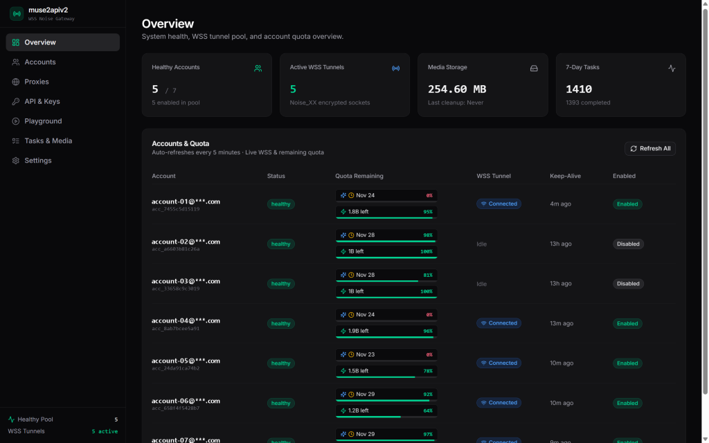
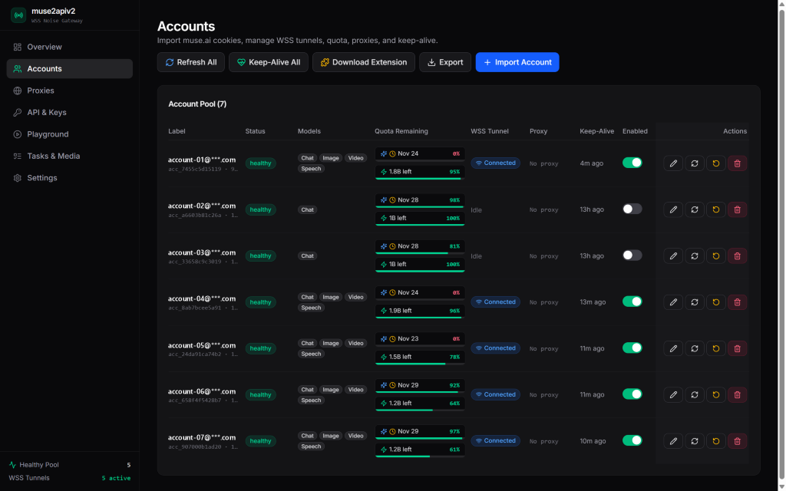
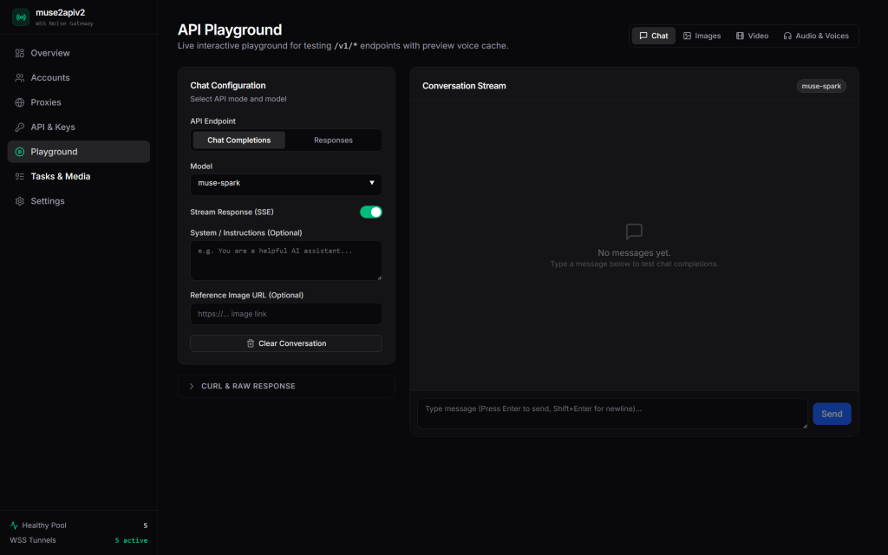
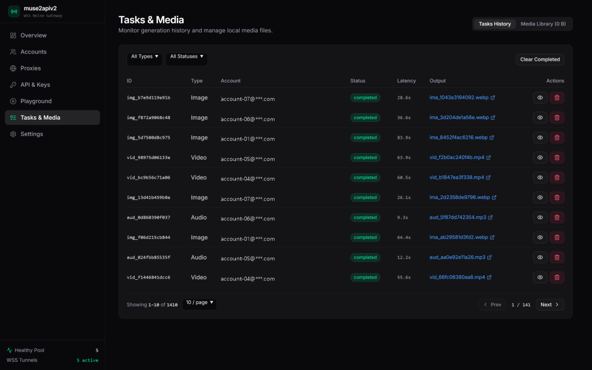

# muse2apiv2

OpenAI-compatible API Gateway (`/v1/*`) và Admin Console cho **muse.ai**, giao tiếp trực tiếp qua HTTPS + WSS (`Noise_XX_25519_AESGCM_SHA256` & Protobuf).

> **Siêu nhẹ & tiết kiệm tài nguyên:** Không sử dụng Chrome headless / Chromium shell (Playwright/Puppeteer), chỉ tiêu tốn khoảng **~50MB RAM** trong quá trình vận hành.









## Tính năng chính

- **OpenAI `/v1/*` API Parity (Chat, Image, Video, TTS):** Hỗ trợ đầy đủ `/v1/models`, `/v1/chat/completions` (streaming SSE & non-stream), `/v1/responses`, `/v1/images/generations`, `/v1/images/edits`, `/v1/images/tasks`, `/v1/videos` (`/v1/videos/generations`), `/v1/audio/speech`, `/v1/audio/voices`, `/v1/audio/voices/{voice_id}/preview`, `/v1/media/{filename}`, `/v1/voice-previews/{filename}`.
- **Text-to-Speech (TTS), Voice Catalog & Audio Normalization:** Tích hợp 334 giọng đọc chia theo 31 nhóm ngôn ngữ/quốc gia (có thể lọc **Voice Languages** trong Settings), cache đĩa cho mẫu nghe thử (`data/voice_previews/`), hỗ trợ emotion cues (`instructions`), xuất `mp3`/`wav`/`url`/`json`, và chuẩn hóa âm lượng cục bộ bằng `ffmpeg` 2-pass `loudnorm` (`-16 LUFS`, true peak `-1.5 dB`).
- **API Playground tích hợp:** Test trực tiếp Chat (streaming), Image, Video, TTS & nghe thử giọng đọc ngay trên Admin Console kèm snippet `curl` sinh sẵn.
- **Account Pool, Capability Routing & Auto-Skip Quota:** Điều phối LRU + failover tự động, phân loại **Supported Models** (`chat`, `image`, `video`, `speech`) theo từng tài khoản, tự bỏ qua tài khoản hết quota (chỉ skip khi `weekly_pct >= 100` và không còn token bổ sung `extra_pct < 100`).
- **Reset Muse thủ công & Auto-Reset định kỳ:** Xóa sạch dữ liệu VM `muse.ai` (lịch sử chat, file, task) từ nút **Reset Muse** trong modal **Edit Account** (drain các request `/v1/*` đang chạy trước khi reset) hoặc bật **Auto Reset** theo lịch trong Settings.
- **WSS Tunnel, Unified Refresh & Keep-Alive chạy ngầm:** Tự động duy trì kết nối WSS Tunnel định kỳ, làm mới trạng thái/WSS/quota hợp nhất, cập nhật trạng thái (`healthy`, `expired`, `cooldown`, `resetting`) realtime lên UI.
- **Proxy Management:** Import nhiều dòng (`http`/`https`/`socks4`/`socks5`), kiểm tra IP/vị trí/latency qua `ipinfo.io`, gán proxy cho tài khoản và tự gỡ khi xóa proxy.
- **Chrome Extension Cookie Manager:** Tải trực tiếp từ **Accounts → Download Extension** (`.zip`), hỗ trợ **Copy Cookies** (`HttpOnly`), **Import Cookie** vào trình duyệt, và **Clear Site Data/Cookies** cho `muse.ai`; hỗ trợ copy cookie trực tiếp từ modal **Edit Account**.
- **Tasks, Input Request & Media Cleanup:** Phân trang server-side cho Tasks & Media, lưu **Input Request** của từng task để xem chi tiết dạng JSON, xem trước ảnh/video/audio qua modal, xóa task kèm dọn file media và auto-cleanup theo thời gian/dung lượng.

---

## API Endpoints hỗ trợ

### Xác thực

- **Nhóm `/v1/*`:** Bắt buộc header `Authorization: Bearer <API_KEY>` khớp với Client API Key trong Console (ngoại trừ `GET /v1/media/{filename}` và `GET /v1/voice-previews/{filename}` phục vụ public file).
- **Nhóm `/admin/*`, `/healthz`, `/readyz`:** Không yêu cầu xác thực.

### OpenAI-Compatible API (`/v1/*`)

| Method | Path                                                                       | Mô tả & Tham số chính                                                                                                                       |
| ------ | -------------------------------------------------------------------------- | ------------------------------------------------------------------------------------------------------------------------------------------- |
| `GET`  | `/v1/models`                                                               | Liệt kê danh sách model alias được hỗ trợ (`muse-spark`, `muse-image`, `muse-video`, `muse-tts`, `tts-1`, `gpt-4o`, `claude-*`, ...).       |
| `POST` | `/v1/chat/completions`                                                     | Chat completions hỗ trợ `stream=true` (SSE) & non-stream, `messages`, `prompt`, `tools`, `timeout`.                                         |
| `POST` | `/v1/responses`                                                            | OpenAI Responses API hỗ trợ `input`, `instructions`, `stream=true` & non-stream.                                                            |
| `POST` | `/v1/images/generations`                                                   | Sinh ảnh từ `prompt`; hỗ trợ `n`, `size`/`aspect_ratio`, `response_format` (`url`/`b64_json`), `async=true`, ảnh tham chiếu.                |
| `POST` | `/v1/images/edits`                                                         | Chỉnh sửa ảnh với ảnh tham chiếu (`image`/`images`/`reference_image`, `multipart/form-data` hoặc JSON).                                     |
| `POST` | `/v1/images/tasks`                                                         | Tạo task sinh ảnh bất đồng bộ, trả `task_id` để poll tiến trình.                                                                            |
| `GET`  | `/v1/images/tasks/{task_id}`                                               | Tra cứu trạng thái & kết quả của task sinh ảnh bất đồng bộ.                                                                                 |
| `POST` | `/v1/videos` <br> `/v1/videos/generations`                                 | Tạo task sinh video (text-to-video & image-to-video) hỗ trợ `duration`, `size`/`aspect_ratio`, `resolution`, reference media.               |
| `GET`  | `/v1/videos/{task_id}` <br> `/v1/videos/generations/{task_id}`             | Tra cứu tiến trình (`progress`) & kết quả video theo `task_id`.                                                                             |
| `GET`  | `/v1/audio/voices` <br> `/v1/voices`                                       | Liệt kê & lọc giọng TTS theo `gender`, `accent`, `language`, `tone`, `q`; kèm `language_group`, `cached` & `preview_url`.                   |
| `GET`  | `/v1/audio/voices/{voice_id}/preview` <br> `/v1/voices/{voice_id}/preview` | Nghe thử mẫu giọng TTS có cache đĩa (`response_format`: `mp3`/`url`/`json`, `refresh=true`, `language`).                                    |
| `POST` | `/v1/audio/speech`                                                         | Sinh giọng nói TTS (`input` tối đa 4096 ký tự, `voice`, `instructions` emotion cues, `speed`, `response_format`: `mp3`/`wav`/`url`/`json`). |
| `GET`  | `/v1/media/{filename}`                                                     | Phục vụ file ảnh/video/audio đã tải về trong `data/media/` (public).                                                                        |
| `GET`  | `/v1/voice-previews/{filename}`                                            | Phục vụ file mẫu giọng đọc đã cache trong `data/voice_previews/` (public).                                                                  |

### Health & Admin Console API (`/healthz`, `/readyz`, `/admin/*`)

| Nhóm                     | Endpoints                                                                                                                                                                                                                                                                                                                                                                                                                                                                                                                                                                                          |
| ------------------------ | -------------------------------------------------------------------------------------------------------------------------------------------------------------------------------------------------------------------------------------------------------------------------------------------------------------------------------------------------------------------------------------------------------------------------------------------------------------------------------------------------------------------------------------------------------------------------------------------------- |
| **Health**               | `GET /healthz`, `GET /readyz`                                                                                                                                                                                                                                                                                                                                                                                                                                                                                                                                                                      |
| **Dashboard**            | `GET /admin/dashboard`                                                                                                                                                                                                                                                                                                                                                                                                                                                                                                                                                                             |
| **Accounts & Extension** | `GET /admin/accounts`, `POST /admin/accounts`, `PATCH /admin/accounts/{id}`, `DELETE /admin/accounts/{id}`, `GET /admin/accounts/{id}/cookies`, `POST /admin/accounts/{id}/refresh`, `POST /admin/accounts/refresh`, `POST /admin/accounts/{id}/test`, `POST /admin/accounts/{id}/quota`, `POST /admin/accounts/quota`, `GET /admin/accounts/export`, `POST /admin/accounts/{id}/keepalive`, `POST /admin/accounts/keepalive`, `GET /admin/keepalive/logs`, `POST /admin/accounts/{id}/reset`, `POST /admin/accounts/reset-due`, `GET /admin/accounts/reset-logs`, `GET /admin/extension/download` |
| **Proxies**              | `GET /admin/proxies`, `POST /admin/proxies/import`, `POST /admin/proxies/{id}/check`, `POST /admin/proxies/check-all`, `DELETE /admin/proxies/{id}`                                                                                                                                                                                                                                                                                                                                                                                                                                                |
| **API Key**              | `GET /admin/apikey`, `POST /admin/apikey/rotate`                                                                                                                                                                                                                                                                                                                                                                                                                                                                                                                                                   |
| **Tasks & Media**        | `GET /admin/tasks`, `GET /admin/tasks/{id}`, `DELETE /admin/tasks/{id}`, `POST /admin/tasks/clear`, `GET /admin/media`, `POST /admin/media/delete`, `DELETE /admin/media/{filename}`                                                                                                                                                                                                                                                                                                                                                                                                               |
| **Settings & Cleanup**   | `GET /admin/settings`, `POST /admin/settings`, `POST /admin/cleanup/run`                                                                                                                                                                                                                                                                                                                                                                                                                                                                                                                           |
| **Voice Preview Cache**  | `GET /admin/voices/preview/stats`, `DELETE /admin/voices/preview`, `DELETE /admin/voices/preview/{voice_id}`                                                                                                                                                                                                                                                                                                                                                                                                                                                                                       |

---

## Chạy bằng Docker Compose (Khuyến nghị)

### 1. Chuẩn bị file cấu hình `.env`

```bash
cp .env.example .env
```

Có thể chỉnh lại các biến trong `.env` nếu cần (ví dụ `MUSE2API_PORT=9123`, `MUSE2API_KEY=...`, `MUSE2API_AUDIO_NORMALIZE=1`).

### 2. Build & khởi chạy container

```bash
docker compose up -d --build
```

Container sẽ build frontend React + cài dependencies backend bằng `uv`, sau đó khởi động dịch vụ trên cổng `8000` bên trong container và map ra cổng host `9123` (hoặc theo `MUSE2API_PORT` trong `.env`).

### 3. Truy cập & quản lý container

- Mở Admin Console tại: `http://127.0.0.1:9123` (hoặc port `MUSE2API_PORT` bạn đã cấu hình).
- Kiểm tra trạng thái & healthcheck:
  ```bash
  docker compose ps
  ```
- Xem logs realtime:
  ```bash
  docker compose logs -f muse2apiv2
  ```
- Dừng dịch vụ:
  ```bash
  docker compose down
  ```
- Cập nhật code mới và build lại:
  ```bash
  git pull
  docker compose up -d --build
  ```

> **Lưu ý dữ liệu:** Database SQLite (`muse2apiv2.db`) được lưu trên Docker named volume native Linux `muse2apiv2_db:/app/db` (chế độ `WAL`, có tự động `PRAGMA integrity_check` & phục hồi khi khởi động), còn `media/` và `voice_previews/` được mount ra `./data:/app/data` trên máy host nên không bị mất khi restart hoặc build lại container.

---

## Chạy Local (Development)

### 1. Cấu hình môi trường

```bash
cp .env.example .env
```

### 2. Build Frontend

```bash
cd packages/frontend
npm install
npm run build
```

### 3. Chạy Backend bằng `uv`

```bash
cd packages/backend
uv sync
uv run uvicorn main:app --host 0.0.0.0 --port 18610
```

Hoặc chạy trực tiếp `main.py`:

```bash
cd packages/backend
uv run python main.py
```

Sau khi khởi động, mở trình duyệt tại `http://127.0.0.1:18610` để truy cập Admin Console.

---

## Hướng dẫn lấy Cookie bằng Extension

1. Vào trang **Accounts** trên Console, bấm **Download Extension** để tải `muse2apiv2-extension.zip` và giải nén.
2. Mở Chrome/Edge tại `chrome://extensions`, bật **Developer mode**, chọn **Load unpacked** và trỏ vào thư mục vừa giải nén.
3. Đăng nhập `https://muse.ai`, bấm icon extension → **Copy Cookies** (hỗ trợ cả **Import Cookie** vào trình duyệt hoặc **Clear Site Data/Cookies** khi đổi tài khoản), sau đó dán vào modal **Import Account**.
