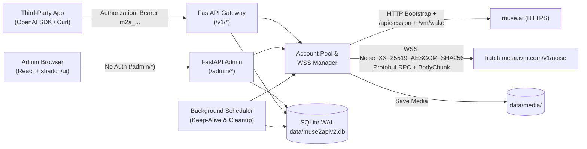

# System Architecture — Kiến trúc tổng thể

## 1. Sơ đồ kiến trúc hệ thống

## 2. Kiến trúc lớp giao tiếp `muse.ai` WSS

1. **HTTP Bootstrap:** Gọi `GET https://muse.ai/thread/new` kèm cookie để lấy `__HATCH_GATEWAY_INIT__` (`vmName`, `authToken`, `noiseNotaryToken`).
2. **Noise Handshake (`Noise_XX_25519_AESGCM_SHA256`):**
   - Kết nối tới `wss://hatch.metaaivm.com/v1/noise?vm_id=...&auth_token=...&notary_token=...&app_id=hatch-web&app_version=1&request_id=...` (kèm `Origin: https://muse.ai` và `Cookie`).
   - Trao đổi 3 binary frames: `Msg 1` (`32B` ephemeral `e` + protobuf `clientNonce`), `Msg 2` (`re` + encrypted `rs` + attestation payload), `Msg 3` (encrypted `s` + empty payload) → `split()` ra cặp `CipherState` AES-256-GCM.
3. **Protobuf 3 lớp (`NoiseTransportFrame` → `ServiceRequest`/`ServiceResponse` → `ServiceFrame`):**
   - Hỗ trợ chunking (`chunk_id`, `chunk_index`, `total_chunks`, tối đa `65489` bytes/chunk) và multiplexing qua `stream_id`.
   - Giao tiếp HTTP-over-Noise: `POST /chat/stream` → `POST /chat/subscribe` → `GET /chat/history` → `GET /media/raw/<path>`.
   - Toàn bộ media của VM chỉ truy cập được qua tunnel này do `<vm_id>.metaaivm.com` không phân giải qua DNS công cộng.

## 3. Đóng gói & Triển khai (Git & Docker)

- **Git Repository:** Khởi tạo Git tại root dự án kèm `.gitignore` loại trừ `.env`, `data/` (SQLite DB, media, master key), `node_modules/`, `frontend/dist/`, `__pycache__/`, `.venv/`.
- **Docker Multi-stage (`Dockerfile`):**
  1. Stage `frontend-builder` (`node:20-alpine`): cài dependencies và chạy `npm run build` tạo `frontend/dist`.
  2. Stage `runtime` (`python:3.12-slim`): cài `backend/requirements.txt`, copy `backend/`, `extension/`, `.env.example` và `frontend/dist` từ stage 1; chạy `uvicorn main:app --host 0.0.0.0 --port 8000` tại `/app/backend`.
- **Docker Compose (`docker-compose.yml`):**
  - Mount volume `./data:/app/data` để lưu trữ bền vững SQLite DB và media.
  - Nạp biến môi trường từ `.env` (nếu có) với mặc định `MUSE2API_DATA_DIR=/app/data`.
  - Expose cổng `${MUSE2API_PORT:-8000}:8000`, chính sách `restart: unless-stopped`, và `healthcheck` kiểm tra `/health`.
