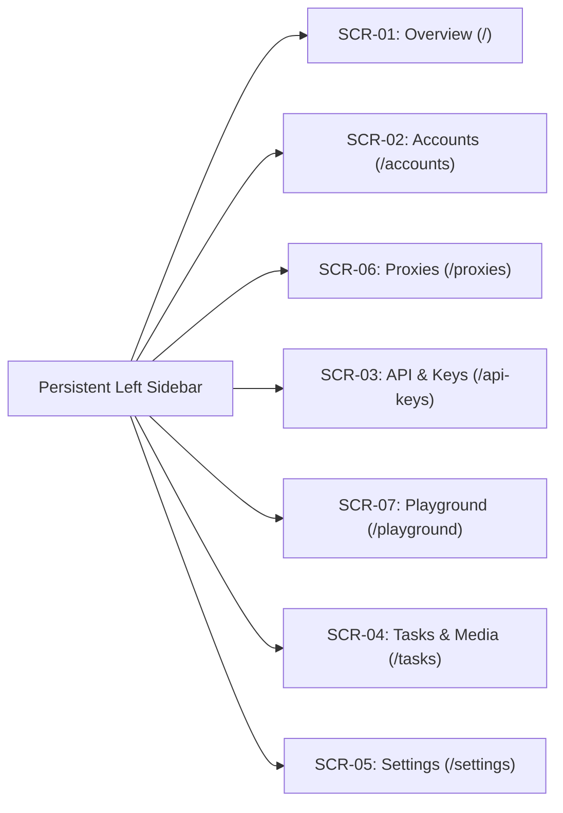

# Screens Overview — Danh sách màn hình & Điều hướng

Giao diện quản trị sử dụng **ReactJS + shadcn/ui** (ngôn ngữ Tiếng Anh), bố cục **Sidebar → Content** với theme Dark-First (`zinc-950` / `zinc-900`, accent `Emerald` cho trạng thái kết nối và `Blue` cho hành động chính).

## 1. Danh sách màn hình

| Screen ID | Tên màn hình      | Route         | Chức năng chính                                                                                  | Tài liệu chi tiết                                                     |
| --------- | ----------------- | ------------- | ------------------------------------------------------------------------------------------------ | --------------------------------------------------------------------- |
| `SCR-01`  | **Overview**      | `/`           | Health pool, tổng quota, biểu đồ task 7 ngày, recent tasks                                       | [Tasks & Media](../03_features/03_tasks_and_media/design.md)          |
| `SCR-02`  | **Accounts**      | `/accounts`   | Danh sách tài khoản, Import Cookie, Gắn Proxy, Tải Extension, Test WSS, Quota, Keep-Alive        | [Accounts Design](../03_features/01_accounts_and_keepalive/design.md) |
| `SCR-03`  | **API & Keys**    | `/api-keys`   | Xem/Copy/Rotate 1 API Key raw, Input/Output schema cho `/v1/*`                                   | [API & Keys Design](../03_features/02_openai_api_and_keys/design.md)  |
| `SCR-04`  | **Tasks & Media** | `/tasks`      | Bảng tasks realtime, lọc trạng thái/loại, xóa/clear, xem/xóa media                               | [Tasks & Media Design](../03_features/03_tasks_and_media/design.md)   |
| `SCR-05`  | **Settings**      | `/settings`   | Global System Prompt, Media Cleanup policy, Run Cleanup Now                                      | [Settings Design](../03_features/04_settings_and_cleanup/design.md)   |
| `SCR-06`  | **Proxies**       | `/proxies`    | Import nhiều dòng proxy, check IP/trạng thái qua `ipinfo`, xóa proxy                             | [Proxies Design](../03_features/05_proxy_management/design.md)        |
| `SCR-07`  | **Playground**    | `/playground` | Kiểm thử trực tiếp API `/v1/*` (Chat, Images, Video, Audio), duyệt & nghe thử giọng đọc có cache | [API Playground Design](../03_features/06_api_playground/design.md)   |

## 2. Sơ đồ chuyển trang (Sidebar Navigation)

