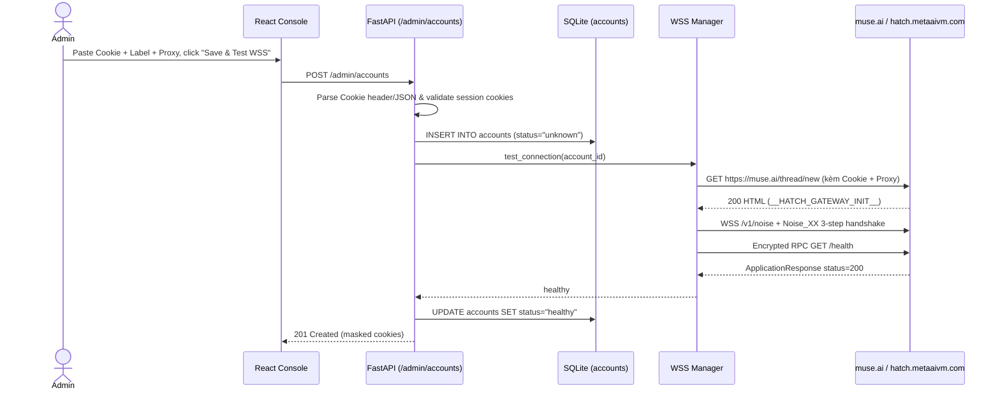

# Logic Design: Accounts & Keep-Alive

## 1. Sequence Diagram — Import & Test WSS Connection

## 2. UI Event Handlers

| Phần tử UI | Sự kiện | API Endpoint | Tham số truyền vào |
|---|---|---|---|
| `+ Import Account` → `Save & Test WSS` | `onSubmit` | `POST /admin/accounts` | `{label, cookies_raw, proxy_id, enabled, supported_models}` |
| `Edit` → `Save Changes` | `onSubmit` | `PATCH /admin/accounts/{id}` | `{label, cookies_raw?, proxy_id, enabled, supported_models}` |
| `Edit` → `Copy Cookie String` | `onClick` | `GET /admin/accounts/{id}/cookies` | `account_id` |
| `Refresh` (row) | `onClick` | `POST /admin/accounts/{id}/refresh` | `account_id` |
| `Refresh All` | `onClick` | `POST /admin/accounts/refresh` | `{}` |
| `Enabled` switch | `onChange` | `PATCH /admin/accounts/{id}` | `{enabled: boolean}` |
| `Keep-Alive All` | `onClick` | `POST /admin/accounts/keepalive` | `{}` |
| `Export` | `onClick` | `GET /admin/accounts/export` | `{}` |
| `Download Extension` | `onClick` | `GET /admin/extension/download` | `{}` |
| `Delete` | `onClick` | `DELETE /admin/accounts/{id}` | `account_id` |

## 3. Thuật toán Keep-Alive, Cookie Parser & Supported Models
- **Cookie Parser:** Hỗ trợ 2 định dạng:
  1. JSON array/dict (`[{"name": ..., "value": ...}]` hoặc `{"hatch_sess": "..."}`).
  2. Raw `Cookie:` header string (`k1=v1; k2=v2; ...`), tách theo `;`, giữ nguyên giá trị chứa `=`.
- **Keep-Alive Scheduler (chu kỳ 20 phút):**
  1. Query `SELECT * FROM accounts WHERE enabled = 1`.
  2. Với mỗi tài khoản: gọi `GET https://muse.ai/api/session` qua proxy của tài khoản (nếu có).
  3. Nếu HTTP `401`: đánh dấu `status = 'expired'`, ghi `keepalive_logs`.
  4. Nếu `vm_state != 'RUNNING'`: gọi `POST https://muse.ai/api/hatch/vm/wake`, cập nhật `last_keepalive_at`, ghi `keepalive_logs`.
- **Chuẩn hóa, Validate & Migration `supported_models` (`FR-013`, `BR-005`):**
  - Tập hằng số chuẩn: `SUPPORTED_MODEL_TYPES = ("chat", "image", "video", "speech")`.
  - **Migration SQLite (`Database.init_schema`):** Kiểm tra `PRAGMA table_info(accounts)`; nếu chưa có cột `supported_models_json`, chạy `ALTER TABLE accounts ADD COLUMN supported_models_json TEXT NOT NULL DEFAULT '["chat","image","video","speech"]'`. Khi đọc bản ghi cũ hoặc cột rỗng/lỗi JSON, fallback về `["chat", "image", "video", "speech"]`.
  - **Validate đầu vào (`normalize_supported_models`):**
    1. Nếu không truyền trong `POST /admin/accounts`: dùng mặc định `["chat", "image", "video", "speech"]`.
    2. Nếu truyền `supported_models` (trên `POST /admin/accounts` hoặc có mặt trong `model_fields_set` của `PATCH /admin/accounts/{id}`): chuẩn hóa từng phần tử bằng `strip().lower()`.
    3. Nếu có phần tử không thuộc `{"chat", "image", "video", "speech"}` hoặc danh sách sau lọc rỗng (`len == 0`): raise lỗi `400 Bad Request` (`"supported_models must contain at least one of: chat, image, video, speech"`).
    4. Loại bỏ trùng lặp và sắp xếp theo thứ tự cố định `["chat", "image", "video", "speech"]`, lưu JSON vào `accounts.supported_models_json`.
  - **Serialization & Export:** `_serialize_account` và `GET /admin/accounts/export` luôn trả trường `"supported_models": list[str]`. Trên `PATCH /admin/accounts/{id}`, việc chỉ đổi `supported_models` không gọi `pool.close_account(account_id)`.
