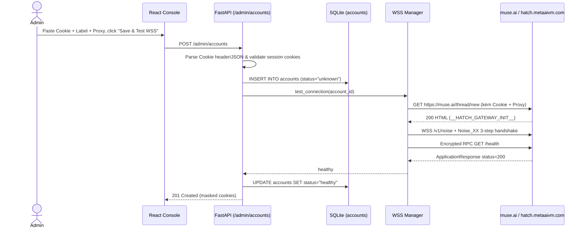

# Logic Design: Accounts & Keep-Alive

## 1. Sequence Diagram — Import & Test WSS Connection

## 2. UI Event Handlers

| Phần tử UI | Sự kiện | API Endpoint | Tham số truyền vào |
|---|---|---|---|
| `+ Import Account` → `Save & Test WSS` | `onSubmit` | `POST /admin/accounts` | `{label, cookies_raw, proxy_url, enabled}` |
| `Test Proxy` | `onClick` | `POST /admin/accounts/{id}/proxy/test` | `{proxy_url}` |
| `Test WSS` | `onClick` | `POST /admin/accounts/{id}/test` | `account_id` |
| `Quota` | `onClick` | `POST /admin/accounts/{id}/quota` | `account_id` |
| `Enabled` switch | `onChange` | `PATCH /admin/accounts/{id}` | `{enabled: boolean}` |
| `Keep-Alive` (row) | `onClick` | `POST /admin/accounts/{id}/keepalive` | `account_id` |
| `Keep-Alive All` | `onClick` | `POST /admin/accounts/keepalive` | `{}` |
| `Delete` | `onClick` | `DELETE /admin/accounts/{id}` | `account_id` |

## 3. Thuật toán Keep-Alive & Cookie Parser
- **Cookie Parser:** Hỗ trợ 2 định dạng:
  1. JSON array/dict (`[{"name": ..., "value": ...}]` hoặc `{"hatch_sess": "..."}`).
  2. Raw `Cookie:` header string (`k1=v1; k2=v2; ...`), tách theo `;`, giữ nguyên giá trị chứa `=`.
- **Keep-Alive Scheduler (chu kỳ 20 phút):**
  1. Query `SELECT * FROM accounts WHERE enabled = 1`.
  2. Với mỗi tài khoản: gọi `GET https://muse.ai/api/session` qua proxy của tài khoản (nếu có).
  3. Nếu HTTP `401`: đánh dấu `status = 'expired'`, ghi `keepalive_logs`.
  4. Nếu `vm_state != 'RUNNING'`: gọi `POST https://muse.ai/api/hatch/vm/wake`, cập nhật `last_keepalive_at`, ghi `keepalive_logs`.
