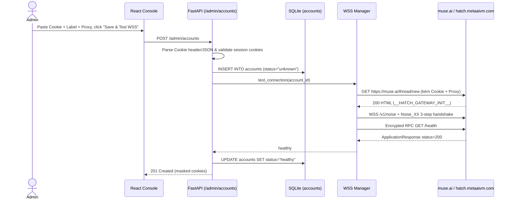
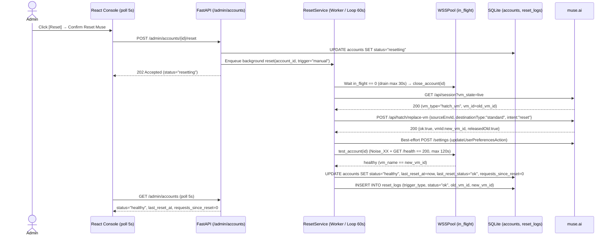

# Logic Design: Accounts & Keep-Alive

## 1. Sequence Diagram — Import & Test WSS Connection

## 1b. Sequence Diagram — Manual Reset Muse & Periodic Auto-Reset

## 2. UI Event Handlers

| Phần tử UI                             | Sự kiện    | API Endpoint                        | Tham số truyền vào                                                       |
| -------------------------------------- | ---------- | ----------------------------------- | ------------------------------------------------------------------------ |
| `+ Import Account` → `Save & Test WSS` | `onSubmit` | `POST /admin/accounts`              | `{label, cookies_raw, proxy_id, enabled, supported_models, auto_reset}`  |
| `Edit` → `Save Changes`                | `onSubmit` | `PATCH /admin/accounts/{id}`        | `{label, cookies_raw?, proxy_id, enabled, supported_models, auto_reset}` |
| `Edit` → `Copy Cookie String`          | `onClick`  | `GET /admin/accounts/{id}/cookies`  | `account_id`                                                             |
| `Reset` (row) → `Confirm Reset`        | `onClick`  | `POST /admin/accounts/{id}/reset`   | `account_id`                                                             |
| `Refresh` (row)                        | `onClick`  | `POST /admin/accounts/{id}/refresh` | `account_id`                                                             |
| `Refresh All`                          | `onClick`  | `POST /admin/accounts/refresh`      | `{}`                                                                     |
| `Enabled` switch                       | `onChange` | `PATCH /admin/accounts/{id}`        | `{enabled: boolean}`                                                     |
| `Keep-Alive All`                       | `onClick`  | `POST /admin/accounts/keepalive`    | `{}`                                                                     |
| `Export`                               | `onClick`  | `GET /admin/accounts/export`        | `{}`                                                                     |
| `Download Extension`                   | `onClick`  | `GET /admin/extension/download`     | `{}`                                                                     |
| `Delete`                               | `onClick`  | `DELETE /admin/accounts/{id}`       | `account_id`                                                             |

## 3. Thuật toán Keep-Alive, Cookie Parser & Supported Models

- **Cookie Parser:** Hỗ trợ 2 định dạng:
  1. JSON array/dict (`[{"name": ..., "value": ...}]` hoặc `{"hatch_sess": "..."}`).
  2. Raw `Cookie:` header string (`k1=v1; k2=v2; ...`), tách theo `;`, giữ nguyên giá trị chứa `=`.
- **Keep-Alive Scheduler (chu kỳ 20 phút), Gia hạn chủ động & Auto One-Tap Re-login:**
  1. `run_due()` chỉ quét tài khoản `enabled = 1` và `status` không thuộc `("resetting", "expired")`, có `now - last_keepalive_at >= interval_s`.
  2. Với mỗi tài khoản: gọi `GET https://muse.ai/api/session` qua proxy của tài khoản (nếu có); áp dụng `Set-Cookie` trả về (ví dụ `hatch_vml` xoay vòng) và lưu lại `cookies_json` nếu thay đổi.
  3. **Gia hạn trượt chủ động (`POST /api/auth/check`):** Sau khi `/api/session` trả `200`, nếu là Refresh thủ công hoặc đã qua `6 giờ` kể từ lần kiểm tra trước (`auth_check_interval_s = 21600`), gọi `POST https://muse.ai/api/auth/check` để xin gia hạn `hatch_sess` (30 ngày) và `hatch_gw` (1 năm) mới qua `Set-Cookie` mà không đụng tới `__Host-hatch_one_tap`.
  4. Nếu HTTP `401` (hoặc `WSSPool.get_client` / `test_account` gặp `MuseAuthError`) và tài khoản còn `__Host-hatch_one_tap`: tự động chạy chuỗi One-Tap re-login (`POST /api/auth/native/restart` → `/start` nếu `flow_state == "new"` → `/saved-accounts` → `/one-tap-login`), **lưu ngay** `hatch_sess` và `__Host-hatch_one_tap` (nonce mới) vào `cookies_json` trước khi gọi lại `/api/session`, rồi đặt `status = 'healthy'`.
  5. Nếu không có `__Host-hatch_one_tap` hoặc One-Tap thất bại (checkpoint/2FA/unavailable): đánh dấu `status = 'expired'` (hoặc `'cooldown'` nếu lỗi mạng tạm thời), luôn cập nhật `last_keepalive_at = now`, ghi `keepalive_logs`.
  6. Nếu `vm_state != 'RUNNING'`: gọi `POST https://muse.ai/api/hatch/vm/wake`, cập nhật `last_keepalive_at`, ghi `keepalive_logs`.
- **Chuẩn hóa, Validate & Migration `supported_models` (`FR-013`, `BR-005`):**
  - Tập hằng số chuẩn: `SUPPORTED_MODEL_TYPES = ("chat", "image", "video", "speech")`.
  - **Migration SQLite (`Database.init_schema`):** Kiểm tra `PRAGMA table_info(accounts)`; nếu chưa có cột `supported_models_json`, chạy `ALTER TABLE accounts ADD COLUMN supported_models_json TEXT NOT NULL DEFAULT '["chat","image","video","speech"]'`. Khi đọc bản ghi cũ hoặc cột rỗng/lỗi JSON, fallback về `["chat", "image", "video", "speech"]`.
  - **Validate đầu vào (`normalize_supported_models`):**
    1. Nếu không truyền trong `POST /admin/accounts`: dùng mặc định `["chat", "image", "video", "speech"]`.
    2. Nếu truyền `supported_models` (trên `POST /admin/accounts` hoặc có mặt trong `model_fields_set` của `PATCH /admin/accounts/{id}`): chuẩn hóa từng phần tử bằng `strip().lower()`.
    3. Nếu có phần tử không thuộc `{"chat", "image", "video", "speech"}` hoặc danh sách sau lọc rỗng (`len == 0`): raise lỗi `400 Bad Request` (`"supported_models must contain at least one of: chat, image, video, speech"`).
    4. Loại bỏ trùng lặp và sắp xếp theo thứ tự cố định `["chat", "image", "video", "speech"]`, lưu JSON vào `accounts.supported_models_json`.
  - **Serialization & Export:** `_serialize_account` và `GET /admin/accounts/export` luôn trả trường `"supported_models": list[str]`. Trên `PATCH /admin/accounts/{id}`, việc chỉ đổi `supported_models` không gọi `pool.close_account(account_id)`.

## 4. Thuật toán Reset Muse, Đếm Request, Concurrency & Auto-Reset Scheduler (`FR-014`, `FR-015`, `BR-006`..`BR-008`)

1. **Migration SQLite & Crash Recovery (`Database.init_schema` & `lifespan`):**
   - Kiểm tra `PRAGMA table_info(accounts)` và bổ sung nếu thiếu:
     - `auto_reset INTEGER NOT NULL DEFAULT 0`
     - `last_reset_at REAL DEFAULT 0`
     - `last_reset_status TEXT DEFAULT ''`
     - `last_reset_error TEXT DEFAULT ''`
     - `requests_since_reset INTEGER NOT NULL DEFAULT 0`
   - Tạo bảng `reset_logs` (`id`, `account_id`, `trigger_type`, `status`, `old_vm_id`, `new_vm_id`, `message`, `duration_ms`, `created_at`) tách biệt khỏi `keepalive_logs`; mỗi lần `add_reset_log(...)` tự động giữ tối đa `30` bản ghi gần nhất cho mỗi `account_id`.
   - Trong `main.py:lifespan()`, gọi `db.recover_resetting_accounts()` ngay cạnh `db.fail_orphaned_tasks()` để đưa các tài khoản bị treo ở `status = "resetting"` do tắt server đột ngột về `"unknown"`.

2. **Bộ đếm `in_flight` & `requests_since_reset` trên `WSSPool`:**
   - Khi tài khoản được chọn để thực thi `/v1/*` (`execute_chat`, `stream_chat_events`, `generate_media`, `generate_speech`), tăng `in_flight[account_id] += 1` trong khối `try/finally` và gọi `db.increment_requests_since_reset(account_id)` (`UPDATE accounts SET requests_since_reset = requests_since_reset + 1 WHERE id = ?`).
   - Tài khoản có `status == "resetting"` bị loại khỏi `_candidate_accounts()`, đồng thời bị bỏ qua trong `WSSPool.maintain_tunnels()`, `KeepAliveService.run_due()`, và `_refresh_account_full()`.

3. **Quy trình Reset một tài khoản (`ResetService.reset_account(account_id, trigger)`):**
   - Dùng `per-account` reset lock để không chạy chồng chéo 2 tiến trình reset trên cùng 1 tài khoản.
   - Đặt `status = "resetting"` (nếu chưa đặt).
   - **Drain:** Nếu `trigger == "manual"`, chờ `in_flight[account_id] == 0` với timeout tối đa `30s` trước khi gọi `wss_pool.close_account(account_id)`. Nếu `trigger == "auto"` và `in_flight[account_id] > 0`, hoãn ngay lập tức (không ngắt request).
   - **Kiểm tra VM & Gọi `replace-vm`:**
     1. Gọi `GET https://muse.ai/api/session?vm_state=live`: lấy `old_vm_id`, `vm_type`, `vm_selection.revision`. Nếu `vm_type != "hatch_vm"`, dừng và báo lỗi không hỗ trợ CVM (`hatch_cvm`).
     2. Gọi `POST https://muse.ai/api/hatch/replace-vm` với header same-origin và body `{"sourceEnvId": old_vm_id, "destinationType": "standard", "intent": "reset"}`. Kiểm tra `ok == True` và `new_vm_id`.
     3. _(Best-effort)_ Trích `ownerId` từ `GET https://muse.ai/settings` và gọi Server Action `updateUserPreferencesAction` (`next-action: 40076d65709b71539d10a9f0f52656ee03877e4d17`) để đồng bộ `vm_selection.override`.
   - **Xác minh VM mới qua WSS:**
     - Vòng lặp tối đa `120s` (nghỉ `4s`/lần): gọi `MuseWSSClient.connect()` (tự wake VM khi cần) + kiểm tra `client.vm_name == new_vm_id` + `GET /health == 200`.
   - **Cập nhật kết quả:**
     - Thành công: cập nhật `status = "healthy"`, `last_error = ""`, `last_reset_at = now`, `last_reset_status = "ok"`, `last_reset_error = ""`, `requests_since_reset = 0`; ghi `reset_logs` (`status="ok"`, `old_vm_id`, `new_vm_id`, `duration_ms`).
     - Thất bại: giữ nguyên `requests_since_reset` và `last_reset_at`; đặt `status = "expired"` nếu `MuseAuthError` (HTTP `401`), ngược lại đặt `"cooldown"`; cập nhật `last_reset_status = "error"`, `last_reset_error = str(exc)`; ghi `reset_logs` (`status="error"`) và lưu mốc backoff `15 phút` trong `ResetService`.

4. **Vòng lặp nền `ResetService` (Auto-Reset Scheduler):**
   - Poll mỗi `60s` (theo pattern `KeepAliveService._loop()`).
   - Đọc `settings["auto_reset"]` (`enabled`, `interval_minutes >= 60`). Nếu `enabled == False`, bỏ qua.
   - Đếm số tài khoản `healthy` khả dụng (`enabled == 1`, `status == "healthy"`, `not is_quota_exhausted`). Nếu `<= 1`, hoãn toàn bộ lượt quét.
   - Duyệt tuần tự từng tài khoản (chạy tối đa 1 tài khoản/lần); bỏ qua nếu: `not enabled`, `not auto_reset`, `status in ("expired", "resetting")`, `is_quota_exhausted(quota_json)`, `requests_since_reset <= 0`, `in_flight > 0`, đang trong backoff `15 phút`, hoặc `now - last_reset_at < interval_minutes * 60`.
   - Khi bật `auto_reset` từ `false → true` (hoặc tạo mới với `auto_reset = true`) mà `last_reset_at == 0`, đặt `last_reset_at = now` để chờ đủ 1 chu kỳ đầu tiên.
