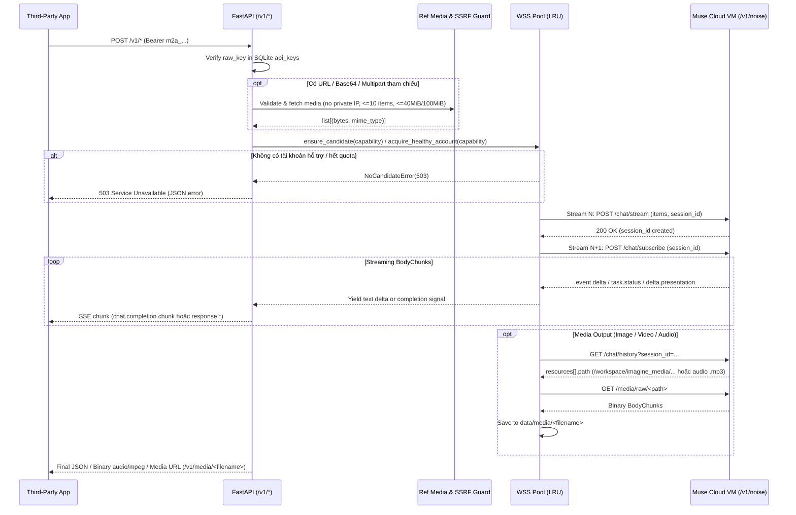

# Logic Design: OpenAI-Compatible API & API Key

## 1. Sequence Diagram — Request qua WSS Noise Tunnel



## 2. UI Event Handlers

| Phần tử UI | Sự kiện | API Endpoint | Tham số |
|---|---|---|---|
| `Show / Hide` | `onClick` | - (client state) | Toggle mask/unmask `raw_key` |
| `Copy Key` | `onClick` | - (clipboard) | Copy `raw_key` |
| `Rotate Key` (confirm) | `onClick` | `POST /admin/apikey/rotate` | `{}` |

## 3. Thuật toán xử lý bổ sung
1. **SSRF Guard cho Reference URL (`BR-104`):**
   - Kiểm tra scheme chỉ cho phép `http`/`https` (hoặc local file nếu `MUSE2API_REF_IMAGE_LOCAL_FILES=1`).
   - Phân giải DNS (`socket.getaddrinfo`) và kiểm tra mọi IP không thuộc `is_private`, `is_loopback`, `is_link_local`, `is_reserved`, `is_multicast` (trừ khi `MUSE2API_REF_IMAGE_PRIVATE_FETCH=1`).
   - Tắt redirect tự động (`allow_redirects=False`) hoặc kiểm tra lại IP ở mỗi hop; giới hạn tối đa 40 MiB/item và 100 MiB tổng.
2. **LRU, Lọc theo `supported_models` & Fail-Fast `503` (`FR-105`, `BR-111`):**
   - Ánh xạ `capability` từ loại lời gọi trong `WSSPool`:
     - `execute_chat` / `stream_chat_events` → `capability = "chat"`
     - `generate_media(..., expect_kind="image")` → `capability = "image"`
     - `generate_media(..., expect_kind="video")` → `capability = "video"`
     - `generate_media(..., expect_kind="audio")` → `capability = "speech"`
   - `_candidate_accounts(capability)`: lọc `enabled = 1`, `status in ('healthy', 'unknown', 'cooldown')`, `not is_quota_exhausted(quota_json)` và `capability in parse_supported_models(supported_models_json)`. Sắp xếp ưu tiên `status == 'healthy'` trước, sau đó tăng dần theo `last_used_at`.
   - `_no_candidate_error(capability)`:
     1. Lấy danh sách `enabled` có chứa `capability` trong `supported_models` (`matching_enabled`).
     2. Nếu `matching_enabled` rỗng → `"No enabled accounts support '<capability>'"`.
     3. Nếu toàn bộ `matching_enabled` đều hết quota (`is_quota_exhausted`) → `"All enabled accounts supporting '<capability>' have exhausted their quota"`.
     4. Ngược lại → `"No healthy enabled accounts available for '<capability>'"`.
   - **Kiểm tra Fail-Fast trên router `v1_openai.py`:** Định nghĩa ngoại lệ riêng `NoCandidateAccountError(MuseWSSError)` và hàm `pool.ensure_candidate(capability)`:
     - Trước khi mở `StreamingResponse` (ở `/v1/chat/completions`, `/v1/responses`), trước khi tạo task `queued` và spawn background thread (ở `/v1/videos`, `/v1/videos/generations`, `/v1/images/tasks`, `async=true` trên `/v1/images/generations` & `/v1/images/edits`), và trong nhánh sync (`/v1/chat/completions`, `/v1/responses`, `/v1/images/*`, `/v1/audio/speech`), gọi `pool.ensure_candidate(capability)` (hoặc bắt `NoCandidateAccountError`) để trả ngay `HTTPException(status_code=503, detail={"error": {"message": ..., "type": "service_unavailable_error"}})` mà không tạo task rác.
   - Nếu `POST /chat/stream` lỗi `401`/timeout trước khi trả chunk đầu tiên, đánh dấu tài khoản và retry sang tài khoản hợp lệ kế tiếp trong cùng tập `candidates`.
3. **SSE Format cho `/v1/responses`:**
   - Bắn lần lượt `event: response.created`, các `event: response.output_text.delta` theo `delta` từ `chat.subscribe`, và `event: response.completed` kèm full output.
4. **Danh mục Giọng, Lọc Ngôn ngữ Settings & Phân giải `voice` (`BR-106`, `BR-109`, `BR-110`):**
   - Nạp danh sách giọng một lần vào bộ nhớ từ `packages/backend/data/voices.json`, lọc bỏ `avocado_v2:p1a1_short` và chuẩn hóa các trường công khai (`id`, `name`, `gender`, `accent`, `tone`, `language`, `description`, `long_description`).
   - Xây dựng 2 chỉ mục tra cứu O(1): `by_id` (khớp chính xác) và `by_name_lower` (khớp không phân biệt hoa thường), cộng bảng `OPENAI_VOICE_ALIASES`:
     - `alloy` → `avocado_v2:MAI_01`
     - `echo` → `avocado_v2:MAI_03`
     - `fable` → `avocado_v2:isabella`
     - `onyx` → `avocado_v2:magnus`
     - `nova` → `avocado_v2:paloma`
     - `shimmer` → `avocado_v2:lumi`
   - Đọc cài đặt `voice_languages` từ SQLite (`db.get_settings().get("voice_languages")`): nếu `enabled == True` và danh sách `languages` sau chuẩn hóa (`normalize_voice_languages`, có tự động mở rộng `"English"` thành 13 nhóm `English (*)`) không rỗng, xác định tập cho phép `allowed_languages: set[str]` (lowercase) theo 31 nhóm chuẩn (`get_voice_language_group(v)` trong `services/voices.py`).
   - `GET /v1/audio/voices` (và `/v1/voices`):
     - Nếu `allowed_languages` khác rỗng: chỉ giữ các giọng có `get_voice_language_group(v).lower() in allowed_languages`.
     - Tiếp tục lọc giao (**AND**) theo query params của client: `gender`, `accent`, `tone` (case-insensitive exact match), `language` (khớp không phân biệt hoa thường với `v["language"]`, `get_voice_language_group(v)`, hoặc khớp toàn bộ 13 nhóm `English (*)` khi client truyền `language="English"`), và `q` (case-insensitive substring trên `id`, `name`, `accent`, `tone`, `description`, `long_description`).
   - `POST /v1/audio/speech`:
     - Phân giải `voice_info = resolve_voice(body.voice)` (trả `400` nếu không tồn tại trong catalog).
     - Nếu `allowed_languages` khác rỗng và `get_voice_language_group(voice_info).lower() not in allowed_languages`: trả ngay `400 Bad Request` (`invalid_request_error`) nêu rõ giọng `{voice_info['name']}` thuộc ngôn ngữ `{lang_group}` hiện không nằm trong danh sách ngôn ngữ được bật trong Settings (không fallback ngay cả khi client bỏ trống `voice`).
5. **Xây dựng Prompt TTS & Trích xuất Audio từ Muse (`BR-107`, `BR-108`):**
   - Validate `input` (`1 <= len(input.strip()) <= 4096`) và `response_format.lower() in {"mp3", "url", "json"}`; nếu sai trả `400`.
   - Ghép prompt TTS theo template chuẩn trong `services/voice_preview.py::build_speech_prompt` (truyền `skip_system_prompt=True` khi gọi `wss_pool.generate_media(..., expect_kind="audio")`):
     ```text
     Generate an MP3 audio speech file using voice "{voice_id}" ({voice_name}).
     Language: {language_code}. Speed: {speed_pct}.
     Style / delivery instructions: {instructions}  # chỉ thêm khi instructions không rỗng

     Do NOT read any bracket tags literally. Convert them to spoken sounds or delivery cues first:
     - [laughs] → "Ha ha ha!"
     - [chuckles], [giggles] → "He he he!"
     - [sighs] → "Haa..."
     - [gasps] → "Huh!"
     - [coughs] → "Hm hm!"
     - [sneezes] → "Achoo!" (or "Hắt xì!" in Vietnamese)
     - [clears throat] → "Hmm!"
     - [pause], [long pause] → "..." (brief / longer pause)
     - [whispers] → read the following words slowly and quietly
     - [shouts] → read faster and louder with emphasis
     - [angry], [sad], [happy], [excited] → adjust pacing and tone to match the mood
     - Any other [tag] → omit the tag, do not speak it literally

     Then speak this text, with the converted sounds in place:
     "{input}"
     ```
     Trong đó `language_code` được ánh xạ từ `get_voice_language_code(voice_info)` (mặc định `en`), và `speed_pct` quy đổi hệ số `speed` sang phần trăm (mặc định `100`, ví dụ `1.25` → `125`).
   - Trong `WSSPool._fetch_media_from_history(..., expect_kind="audio")`:
     - Ưu tiên chọn resource có `kind` chứa `"audio"` hoặc `mime_type` bắt đầu bằng `"audio/"` hoặc đuôi path thuộc `{".mp3", ".wav", ".ogg", ".m4a"}`; đồng thời kiểm tra cả `payload.data.audios` / `payload.data.audio` / `payload.data.files` nếu có.
     - Mặc định phần mở rộng `.mp3` (`mime_type = "audio/mpeg"`), lưu vào `data/media/aud_<hex>.mp3`.
   - Với `response_format == "mp3"`, trả `FileResponse` / `Response` binary kèm header `Content-Type: audio/mpeg` và `X-Muse-Media-Url: /v1/media/<filename>`; với `"url"` hoặc `"json"`, trả JSON metadata kèm đường dẫn đầy đủ.
