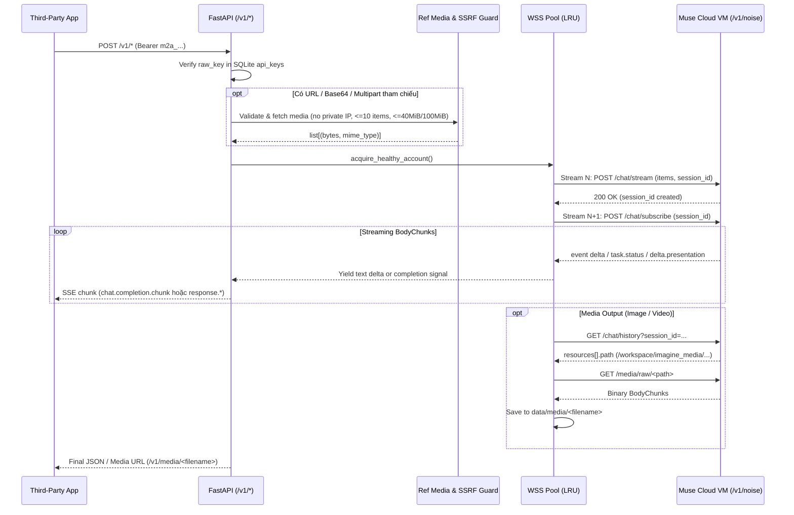

# Logic Design: OpenAI-Compatible API & API Key

## 1. Sequence Diagram — Request qua WSS Noise Tunnel

## 2. UI Event Handlers

| Phần tử UI | Sự kiện | API Endpoint | Tham số |
|---|---|---|---|
| `Show / Hide` | `onClick` | - (client state) | Toggle mask/unmask `raw_key` |
| `Copy Key` | `onClick` | - (clipboard) | Copy `raw_key` |
| `Rotate Key` (confirm) | `onClick` | `POST /admin/apikey/rotate` | `{}` |

## 3. Thuật toán xử lý bổ sung
1. **SSRF Guard cho Reference URL (`BR-104`):**
   - Kiểm tra scheme chỉ cho phép `http`/`https` (hoặc local file nếu `MUSE2API_REF_IMAGE_LOCAL_FILES=1`).
   - Phân giải DNS (`socket.getaddrinfo`) và kiểm tra mọi IP không thuộc `is_private`, `is_loopback`, `is_link_local`, `is_reserved`, `is_multicast` (trừ khi `MUSE2API_REF_IMAGE_PRIVATE_FETCH=1`).
   - Tắt redirect tự động (`allow_redirects=False`) hoặc kiểm tra lại IP ở mỗi hop; giới hạn tối đa 40 MiB/item và 100 MiB tổng.
2. **LRU & Failover:**
   - Lấy danh sách `enabled = 1 AND status = 'healthy'`, sắp xếp tăng dần theo `last_used_at`.
   - Nếu `POST /chat/stream` lỗi `401`/timeout trước khi trả chunk đầu tiên, đánh dấu tài khoản và retry sang tài khoản kế tiếp.
3. **SSE Format cho `/v1/responses`:**
   - Bắn lần lượt `event: response.created`, các `event: response.output_text.delta` theo `delta` từ `chat.subscribe`, và `event: response.completed` kèm full output.
