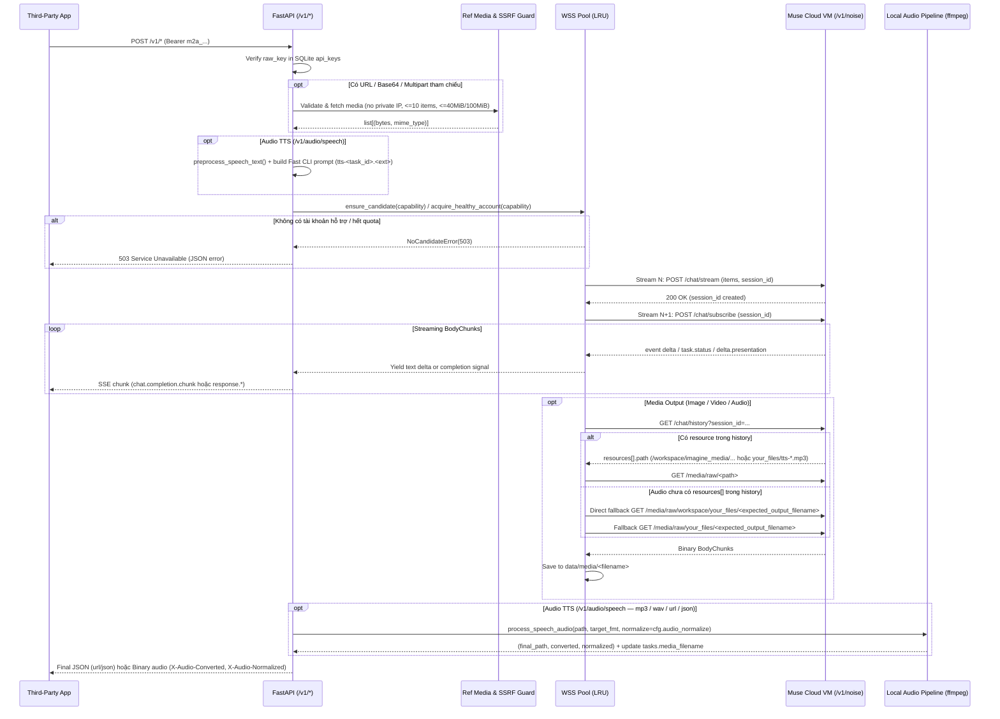

# Logic Design: OpenAI-Compatible API & API Key

## 1. Sequence Diagram — Request qua WSS Noise Tunnel



## 2. UI Event Handlers

| Phần tử UI             | Sự kiện   | API Endpoint                | Tham số                      |
| ---------------------- | --------- | --------------------------- | ---------------------------- |
| `Show / Hide`          | `onClick` | - (client state)            | Toggle mask/unmask `raw_key` |
| `Copy Key`             | `onClick` | - (clipboard)               | Copy `raw_key`               |
| `Rotate Key` (confirm) | `onClick` | `POST /admin/apikey/rotate` | `{}`                         |

## 3. Thuật toán xử lý bổ sung

1. **SSRF Guard cho Reference URL (`BR-104`):**
   - Kiểm tra scheme chỉ cho phép `http`/`https` (hoặc local file nếu `MUSE2API_REF_IMAGE_LOCAL_FILES=1`).
   - Phân giải DNS (`socket.getaddrinfo`) và kiểm tra mọi IP không thuộc `is_private`, `is_loopback`, `is_link_local`, `is_reserved`, `is_multicast` (trừ khi `MUSE2API_REF_IMAGE_PRIVATE_FETCH=1`).
   - Tắt redirect tự động (`allow_redirects=False`) hoặc kiểm tra lại IP ở mỗi hop; giới hạn tối đa 40 MiB/item và 100 MiB tổng.
2. **LRU, Lọc theo `supported_models` & Fail-Fast `503` (`FR-105`, `BR-111`):**
   - Ánh xạ `capability` từ loại lời gọi trong `WSSPool`:
     - `execute_chat` / `stream_chat_events` → `capability = "chat"`
     - `generate_media(..., expect_kind="image")` → `capability = "image"`
     - `generate_media(..., expect_kind="video")` → `capability = "video"`
     - `generate_media(..., expect_kind="audio")` → `capability = "speech"`
   - `_candidate_accounts(capability)`: lọc `enabled = 1`, `status in ('healthy', 'unknown', 'cooldown')`, `not is_quota_exhausted(quota_json)` và `capability in parse_supported_models(supported_models_json)`. Sắp xếp ưu tiên `status == 'healthy'` trước, sau đó tăng dần theo `last_used_at`.
   - `_no_candidate_error(capability)`:
     1. Lấy danh sách `enabled` có chứa `capability` trong `supported_models` (`matching_enabled`).
     2. Nếu `matching_enabled` rỗng → `"No enabled accounts support '<capability>'"`.
     3. Nếu toàn bộ `matching_enabled` đều hết quota (`is_quota_exhausted`) → `"All enabled accounts supporting '<capability>' have exhausted their quota"`.
     4. Ngược lại → `"No healthy enabled accounts available for '<capability>'"`.
   - **Kiểm tra Fail-Fast trên router `v1_openai.py`:** Định nghĩa ngoại lệ riêng `NoCandidateAccountError(MuseWSSError)` và hàm `pool.ensure_candidate(capability)`:
     - Trước khi mở `StreamingResponse` (ở `/v1/chat/completions`, `/v1/responses`), trước khi tạo task `queued` và spawn background thread (ở `/v1/videos`, `/v1/videos/generations`, `/v1/images/tasks`, `async=true` trên `/v1/images/generations` & `/v1/images/edits`), và trong nhánh sync (`/v1/chat/completions`, `/v1/responses`, `/v1/images/*`, `/v1/audio/speech`), gọi `pool.ensure_candidate(capability)` (hoặc bắt `NoCandidateAccountError`) để trả ngay `HTTPException(status_code=503, detail={"error": {"message": ..., "type": "service_unavailable_error"}})` mà không tạo task rác.
   - Nếu `POST /chat/stream` lỗi `401`/timeout trước khi trả chunk đầu tiên, đánh dấu tài khoản và retry sang tài khoản hợp lệ kế tiếp trong cùng tập `candidates`.
3. **SSE Format cho `/v1/responses`:**
   - Bắn lần lượt `event: response.created`, các `event: response.output_text.delta` theo `delta` từ `chat.subscribe`, và `event: response.completed` kèm full output.
4. **Danh mục Giọng, Lọc Ngôn ngữ Settings & Phân giải `voice` (`BR-106`, `BR-109`, `BR-110`):**
   - Nạp danh sách giọng một lần vào bộ nhớ từ `packages/backend/data/voices.json`, lọc bỏ `avocado_v2:p1a1_short` và chuẩn hóa các trường công khai (`id`, `name`, `gender`, `accent`, `tone`, `language`, `description`, `long_description`).
   - Xây dựng 2 chỉ mục tra cứu O(1): `by_id` (khớp chính xác) và `by_name_lower` (khớp không phân biệt hoa thường), cộng bảng `OPENAI_VOICE_ALIASES`:
     - `alloy` → `avocado_v2:MAI_01`
     - `echo` → `avocado_v2:MAI_03`
     - `fable` → `avocado_v2:isabella`
     - `onyx` → `avocado_v2:magnus`
     - `nova` → `avocado_v2:paloma`
     - `shimmer` → `avocado_v2:lumi`
   - Đọc cài đặt `voice_languages` từ SQLite (`db.get_settings().get("voice_languages")`): nếu `enabled == True` và danh sách `languages` sau chuẩn hóa (`normalize_voice_languages`, có tự động mở rộng `"English"` thành 13 nhóm `English (*)`) không rỗng, xác định tập cho phép `allowed_languages: set[str]` (lowercase) theo 31 nhóm chuẩn (`get_voice_language_group(v)` trong `services/voices.py`).
   - `GET /v1/audio/voices` (và `/v1/voices`):
     - Nếu `allowed_languages` khác rỗng: chỉ giữ các giọng có `get_voice_language_group(v).lower() in allowed_languages`.
     - Tiếp tục lọc giao (**AND**) theo query params của client: `gender`, `accent`, `tone` (case-insensitive exact match), `language` (khớp không phân biệt hoa thường với `v["language"]`, `get_voice_language_group(v)`, hoặc khớp toàn bộ 13 nhóm `English (*)` khi client truyền `language="English"`), và `q` (case-insensitive substring trên `id`, `name`, `accent`, `tone`, `description`, `long_description`).
   - `POST /v1/audio/speech`:
     - Phân giải `voice_info = resolve_voice(body.voice)` (trả `400` nếu không tồn tại trong catalog).
     - Nếu `allowed_languages` khác rỗng và `get_voice_language_group(voice_info).lower() not in allowed_languages`: trả ngay `400 Bad Request` (`invalid_request_error`) nêu rõ giọng `{voice_info['name']}` thuộc ngôn ngữ `{lang_group}` hiện không nằm trong danh sách ngôn ngữ được bật trong Settings (không fallback ngay cả khi client bỏ trống `voice`).
5. **Xây dựng Fast Prompt TTS, Tiền xử lý Tag, Tải Audio Fallback & Chuẩn hóa Âm lượng Cục bộ (`BR-107`, `BR-108`):**
   - **Kiểm tra đầu vào cơ bản:** `input` sau trim có độ dài `1..4096` ký tự và `response_format.lower() in {"mp3", "wav", "url", "json"}`; sai trả `400`.
   - **Tiền xử lý bracket tags cục bộ (`services/voice_preview.py::preprocess_speech_text(text: str, language: str) -> str`):**
     - Khớp mọi biểu thức dạng `[...]` không phân biệt hoa/thường (bỏ khoảng trắng thừa bên trong ngoặc trước khi đối chiếu bảng mapping):
       - Ngôn ngữ `"vi"`: `[laughs]` → `, hơ hơ,`; `[chuckles]`, `[giggles]` → `, hơ hơ,`; `[clears throat]` → `, ừm,`; `[sneezes]` → `Hắt xì!`.
       - Ngôn ngữ khác `"vi"`: `[laughs]` → `, haha,`; `[chuckles]`, `[giggles]` → `, heh,`; `[clears throat]` → `, hmm,`; `[sneezes]` → `Achoo!`.
       - Dùng chung mọi ngôn ngữ: `[sighs]` → `Haiz...`; `[gasps]` → `Huh!`; `[coughs]` → `Hm hm!`; `[pause]`, `[long pause]` → `...`.
       - Mọi `[tag]` khác (`[whispers]`, `[shouts]`, `[angry]`, `[sad]`, `[happy]`, `[excited]`, tag lạ): xóa bỏ hoàn toàn (`""`).
     - Sau khi thay/xóa, dọn khoảng trắng ngang liên tiếp, tránh khoảng trắng trước dấu phẩy (`,`) hoặc dấu phẩy lặp (`,,` / dấu phẩy mở đầu câu sau khi xóa tag đầu dòng), nhưng giữ nguyên ngắt dòng giữa các đoạn văn.
     - Nếu `preprocess_speech_text(...)` trả chuỗi rỗng sau trim (ví dụ `input="[whispers]"`), trả ngay `400 Bad Request` (`invalid_request_error`).
   - **Template Fast Prompt (`services/voice_preview.py::build_speech_prompt(..., output_filename: str | None = None)`):**
     - Tạo `task_id = f"aud_{secrets.token_hex(6)}"` trước khi dựng prompt; xác định `target_fmt = "wav" if fmt == "wav" else "mp3"` và tên file duy nhất `output_filename = f"tts-{task_id}.{target_fmt}"` (sanitize qua `os.path.basename` / chỉ cho phép `[a-zA-Z0-9._-]`, fallback sinh `tts-<hex>.<fmt>` nếu trống).
     - `language_code = get_voice_language_code(voice_info)` (mặc định `en`); `speed_pct` quy đổi hệ số `speed` sang phần trăm (mặc định `100`, vd `1.25` → `125`).
     - Tham số `instructions` được nhận ở schema API nhưng **bỏ qua** ở Fast Path (không chèn vào prompt và không fallback sang prompt đọc skill).
     - Ghép prompt nguyên văn theo mẫu sau (gửi với `skip_system_prompt=True`):
       ```text
       Generate an audio speech file using this exact command, do not read any skill files first:

       /opt/hatch/bin/tts speak --voice "{voice_id}" --language {lang} --speed {speed_pct} --format {fmt} --output ~/workspace/your_files/{safe_output_filename} --text-stdin

       Voice: {voice_name} ({voice_id})
       Language: {lang}
       Speed: {speed_pct}
       Format: {fmt}

       Text to speak (already converted, read exactly as written, no bracket tags left):
       {processed_text}
       ```
   - **Trích xuất Audio từ Muse & Direct Download Fallback (`WSSPool.generate_media` / `_fetch_media_from_history`):**
     - `generate_media(..., expected_output_filename: str | None = None)` truyền tên file kỳ vọng xuống `_fetch_media_from_history`.
     - Tại mỗi lượt kiểm tra `/chat/history`:
       1. Tìm trong `chat_events` (`resources[]` và `payload.data.audios/audio/files/...`) resource có `kind` chứa `"audio"` hoặc `mime_type` `audio/*` hoặc đuôi `.mp3`/`.wav`/`.ogg`/`.m4a`; nếu có nhiều mục, ưu tiên mục có path kết thúc bằng `expected_output_filename`.
       2. Nếu tìm thấy, tải qua `GET /media/raw/<media_path>`.
       3. Nếu lượt kiểm tra `/chat/history` chưa thấy resource audio nào và `expected_output_filename` khác rỗng, thử tải trực tiếp lần lượt:
          - `GET /media/raw/workspace/your_files/{expected_output_filename}`
          - `GET /media/raw/your_files/{expected_output_filename}`
            Nếu một trong hai trả `200 OK` với dữ liệu binary khác rỗng, lưu ngay vào `data/media/aud_<hex>.<ext>` mà không phải đợi retry hay báo lỗi `No audio resource produced`.
       4. Chỉ khi cả `/chat/history` lẫn direct fallback đều chưa có file mới `time.sleep(0.8)` rồi thử lại (tối đa 3 lượt).
   - **Pipeline hậu xử lý âm thanh cục bộ (`services/audio_format.py::process_speech_audio`):**
     - Signature: `process_speech_audio(file_path: str, target_format: str, *, normalize: bool = True, target_lufs: float = -16.0, true_peak: float = -1.5, lra: float = 11.0) -> tuple[str, bool, bool]` trả về `(final_path, was_converted, was_normalized)`.
     - Bước 1 — Kiểm tra định dạng: xác định `needs_convert = not matches_target_format(data, target_fmt)` (`RIFF...WAVE` PCM 16-bit cho `wav`; `ID3` hoặc MPEG sync frame cho `mp3`).
     - Bước 2 — Nếu `not normalize`:
       - Nếu `not needs_convert`: đổi tên nguyên tử sang `.<target_fmt>` nếu lệch phần mở rộng và trả `(dst_path, False, False)`.
       - Nếu `needs_convert`: gọi `convert_audio_file` (`pcm_s16le` hoặc `libmp3lame -qscale:a 2`), xóa nguồn cũ nếu khác tên và trả `(dst_path, True, False)`.
     - Bước 3 — Nếu `normalize == True`:
       - Tìm `ffmpeg` (`find_ffmpeg()`). Nếu không có `ffmpeg`:
         - Nếu `needs_convert`: ném `AudioConversionError` (router trả `502`).
         - Nếu `not needs_convert`: ghi log `WARNING`, đổi tên nguyên tử sang `.<target_fmt>` nếu cần và trả `(dst_path, False, False)` (Graceful fallback).
       - Chạy Pass 1 đo thông số loudness:
         `ffmpeg -y -hide_banner -i <src_path> -af loudnorm=I={target_lufs}:TP={true_peak}:LRA={lra}:print_format=json -f null -`
       - Xác định sample rate gốc `orig_sr`: ưu tiên đọc `wf.getframerate()` qua `wave.open` nếu đầu vào là WAV hợp lệ; ngược lại parse regex `(\d+)\s+Hz` từ `stderr` của Pass 1 (tránh chạy thêm tiến trình `ffprobe`).
       - Phân tích khối JSON từ `stderr` của Pass 1:
         - Nếu `input_i == "-inf"` (clip im lặng hoàn toàn): bỏ qua `loudnorm` (`normalized=False`); chỉ convert nếu `needs_convert`, ngược lại giữ file gốc (`(dst_path, False, False)`).
         - Nếu parse đủ `input_i`, `input_tp`, `input_lra`, `input_thresh`, `target_offset`: dựng bộ lọc Pass 2 2-pass linear:
           `loudnorm=I={target_lufs}:TP={true_peak}:LRA={lra}:measured_I={...}:measured_TP={...}:measured_LRA={...}:measured_thresh={...}:offset={...}:linear=true:print_format=summary`
         - Nếu không parse được JSON Pass 1 (nhưng không im lặng): fallback sang bộ lọc 1-pass `loudnorm=I={target_lufs}:TP={true_peak}:LRA={lra}`.
       - Chạy Pass 2 (gộp convert + normalize trong **1 lần encode duy nhất** qua file `.tmp` rồi `os.replace()`):
         - Luôn truyền `-ar {orig_sr}` (nếu xác định được `orig_sr > 0`) để ngăn `loudnorm` upsample nội bộ lên `192000 Hz`.
         - Codec đích: `pcm_s16le -f wav` (với `wav`) hoặc `libmp3lame -qscale:a 2 -f mp3` (với `mp3`).
       - Nếu Pass 1 hoặc Pass 2 lỗi thực thi `ffmpeg`: nếu `needs_convert` thì ném `AudioConversionError`; nếu `not needs_convert` thì ghi `WARNING` và fallback giữ file gốc (`(dst_path, False, False)`).
       - Khi ghi đích thành công, xóa file nguồn cũ nếu đường dẫn khác `dst_path`, trả `(dst_path, needs_convert, True)`.
   - **Cấu hình biến môi trường (`packages/backend/config.py` & `.env.example`):**
     - `MUSE2API_AUDIO_NORMALIZE`: mặc định `"1"` (`bool`, bật chuẩn hóa cục bộ).
     - `MUSE2API_AUDIO_TARGET_LUFS`: mặc định `"-16.0"` (`float`).
     - `MUSE2API_AUDIO_TRUE_PEAK`: mặc định `"-1.5"` (`float`).
     - `MUSE2API_AUDIO_LRA`: mặc định `"11.0"` (`float`).
   - **Hoàn tất phản hồi tại `POST /v1/audio/speech`:**
     - Áp dụng `process_speech_audio` với `target_fmt = "wav" if fmt == "wav" else "mp3"` cho **cả 4 chế độ** `response_format` (`mp3`, `wav`, `url`, `json`).
     - Cập nhật `tasks.media_filename` trong SQLite và `final_size` theo tệp sau xử lý.
     - Với `mp3`/`wav`, trả `FileResponse` (`audio/mpeg` hoặc `audio/wav`) kèm header `X-Muse-Media-Url: /v1/media/<filename>`, `X-Audio-Converted: 0|1`, và `X-Audio-Normalized: 0|1`. Với `url`/`json`, trả JSON metadata trỏ tới `/v1/media/<filename>` đã chuẩn hóa.
