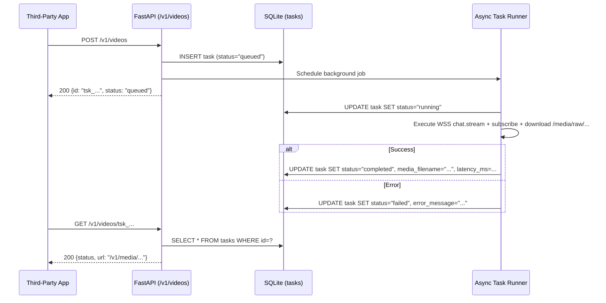

# Logic Design: Tasks & Media Management

## 1. Sequence Diagram — Vòng đời Task bất đồng bộ (Video / Async Image)

## 2. UI Event Handlers

| Phần tử UI | Sự kiện | API Endpoint | Tham số |
|---|---|---|---|
| Filter Type / Status | `onChange` | `GET /admin/tasks` | `?type=...&status=...&limit=50&offset=0` |
| `Delete` (Task) | `onClick` | `DELETE /admin/tasks/{id}` | `task_id` |
| `Clear Completed` | `onClick` | `POST /admin/tasks/clear` | `{}` |
| `Media Library` tab | `onSelect` | `GET /admin/media` | `{}` |
| `Delete` (Media) | `onClick` | `DELETE /admin/media/{name}` | `filename` |
