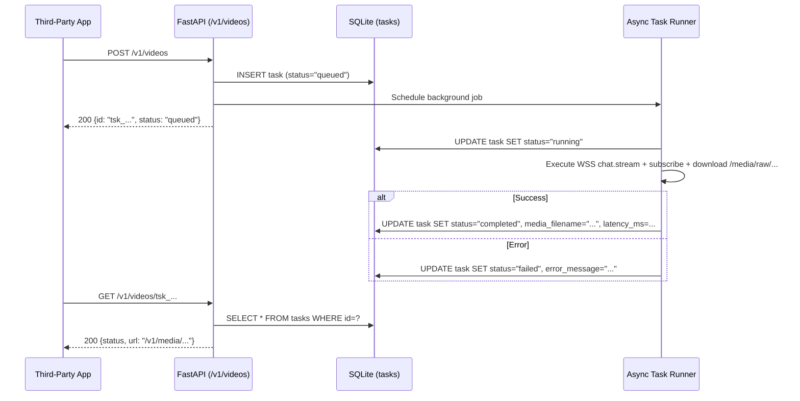

# Logic Design: Tasks & Media Management

## 1. Sequence Diagram — Vòng đời Task bất đồng bộ (Video / Async Image)

## 2. UI Event Handlers

| Phần tử UI | Sự kiện | API Endpoint | Tham số |
|---|---|---|---|
| Filter Type / Status | `onChange` | `GET /admin/tasks` | `?type=...&status=...&page=1&page_size=10` |
| `View` (Task Detail) | `onClick` | `GET /admin/tasks/{id}` | `task_id` |
| `Delete` (Task) | `onClick` | `DELETE /admin/tasks/{id}` | `task_id` |
| `Clear Completed` | `onClick` | `POST /admin/tasks/clear` | `{}` |
| `Media Library` tab | `onSelect` | `GET /admin/media` | `?page=1&page_size=10` |
| `Delete` (Media) | `onClick` | `DELETE /admin/media/{name}` | `filename` |

## 3. Chuẩn hóa & Giới hạn Input Request (`input_request_json`)

1. **Migration DB:** Khi khởi tạo `Database`, kiểm tra `PRAGMA table_info(tasks)`; nếu chưa có cột `input_request_json` thì chạy `ALTER TABLE tasks ADD COLUMN input_request_json TEXT DEFAULT ''`.
2. **Rút gọn dữ liệu nhị phân / base64 (Sanitization):**
   - Duyệt đệ quy payload đầu vào (`dict`, `list`, `str`).
   - Nếu phát hiện Data URI base64 (ví dụ `data:image/...;base64,...`) hoặc chuỗi base64 thô có kích thước lớn (ví dụ trường `image`, `b64_json`), thay thế bằng chuỗi tóm tắt `"[base64 <mime_or_type> ~<KB>KB]"`.
   - Với `multipart/form-data` (`/v1/images/edits`), không lưu raw bytes của file upload; chỉ lưu metadata `{ "filename": ..., "content_type": ..., "size_bytes": ... }`.
3. **Giới hạn kích thước tối đa `32 KB` (`32768` bytes UTF-8):**
   - Serialize JSON compact (`ensure_ascii=False`, `separators=(",", ":")`).
   - Nếu vượt `32768` bytes, giảm dần độ dài các trường `str` dài nhất trong payload (cắt và gắn hậu tố `... [truncated]`) cho đến khi chuỗi JSON kết quả đạt `<= 32768` bytes mà vẫn giữ nguyên cấu trúc JSON hợp lệ.
4. **Truy vấn danh sách vs chi tiết:**
   - `list_tasks` (`GET /admin/tasks`) chỉ select các cột danh sách, loại trừ `input_request_json`.
   - `get_task` (`GET /admin/tasks/{id}`) trả về đầy đủ bản ghi kèm `input_request` đã parse từ `input_request_json`.
