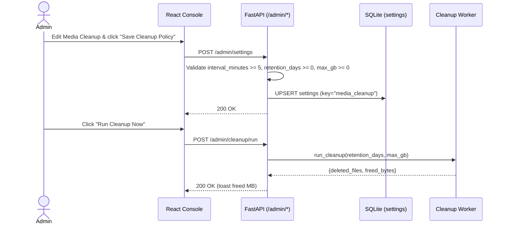

# Logic Design: Settings & Media Cleanup

## 1. Sequence Diagram — Lưu cấu hình & Chạy Media Cleanup

## 2. UI Event Handlers

| Phần tử UI | Sự kiện | API Endpoint | Tham số |
|---|---|---|---|
| `Save Prompt` | `onClick` | `POST /admin/settings` | `{system_prompt: {enabled, prompt}}` |
| `Reset Default` | `onClick` | - (reset local form to default) | - |
| `Save Cleanup Policy` | `onClick` | `POST /admin/settings` | `{media_cleanup: {enabled, retention_days, max_gb, interval_minutes}}` |
| `Run Cleanup Now` | `onClick` | `POST /admin/cleanup/run` | `{}` |

## 3. Thuật toán Media Cleanup
1. Liệt kê toàn bộ file trong `data/media/`, lấy `(path, size, mtime)`.
2. Nếu `retention_days > 0`: xóa mọi file có `now - mtime > retention_days * 86400`.
3. Tính tổng `total_bytes` các file còn lại.
4. Nếu `max_gb > 0` và `total_bytes > max_gb * 1024^3`: sắp xếp file còn lại theo `mtime` tăng dần (cũ nhất trước) và xóa lần lượt cho đến khi `total_bytes <= max_gb * 1024^3`.
