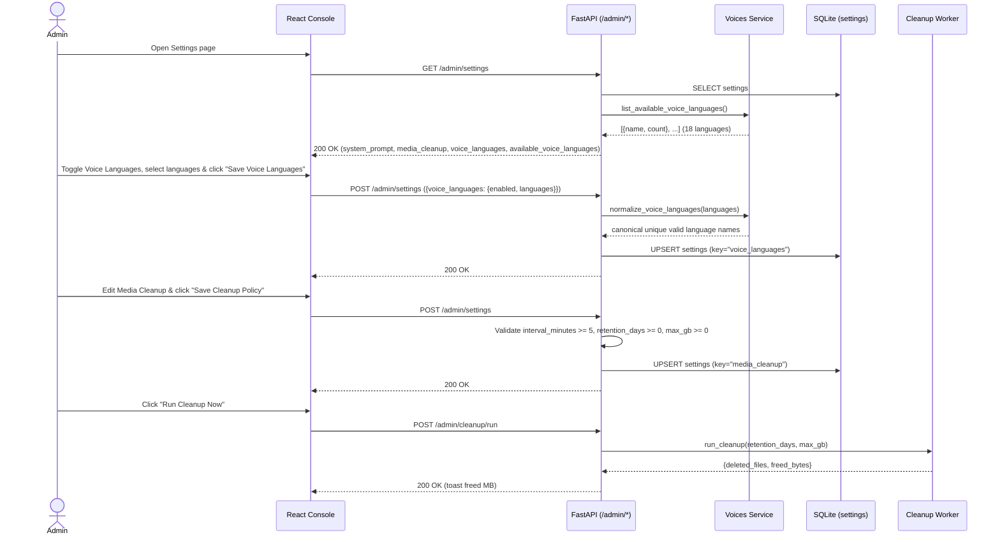

# Logic Design: Settings & Media Cleanup

## 1. Sequence Diagram — Lưu cấu hình & Chạy Media Cleanup

## 2. UI Event Handlers

| Phần tử UI | Sự kiện | API Endpoint | Tham số |
|---|---|---|---|
| `Save Prompt` | `onClick` | `POST /admin/settings` | `{system_prompt: {enabled, prompt}}` |
| `Reset Default` | `onClick` | - (reset local form to default) | - |
| `Voice Languages Switch` | `onCheckedChange` | - (update local `vlEnabled` state) | `boolean` |
| `Language Checkbox / Chip` | `onClick` | - (toggle language in local `vlSelected` set) | `languageName` |
| `Select All` | `onClick` | - (set `vlSelected` to all 18 `available_voice_languages`) | - |
| `Clear` | `onClick` | - (clear `vlSelected` to empty) | - |
| `Save Voice Languages` | `onClick` | `POST /admin/settings` | `{voice_languages: {enabled, languages}}` |
| `Save Cleanup Policy` | `onClick` | `POST /admin/settings` | `{media_cleanup: {enabled, retention_days, max_gb, interval_minutes}}` |
| `Run Cleanup Now` | `onClick` | `POST /admin/cleanup/run` | `{}` |

## 3. Thuật toán Media Cleanup
1. Liệt kê toàn bộ file trong `data/media/`, lấy `(path, size, mtime)`.
2. Nếu `retention_days > 0`: xóa mọi file có `now - mtime > retention_days * 86400`.
3. Tính tổng `total_bytes` các file còn lại.
4. Nếu `max_gb > 0` và `total_bytes > max_gb * 1024^3`: sắp xếp file còn lại theo `mtime` tăng dần (cũ nhất trước) và xóa lần lượt cho đến khi `total_bytes <= max_gb * 1024^3`.

## 4. Thuật toán Phân nhóm & Chuẩn hóa Ngôn ngữ Giọng (`BR-303`, `BR-304`)
1. Trong `packages/backend/services/voices.py`, định nghĩa bảng ánh xạ tĩnh `ACCENT_TO_LANGUAGE_GROUP` (case-insensitive) ánh xạ toàn bộ 36 `accent` về **31 nhóm chuẩn** gồm 13 quốc gia Tiếng Anh (`English (US)`, `English (UK)`, `English (Australia)`, `English (Ireland)`, `English (South Africa)`, `English (Kenya)`, `English (Nigeria)`, `English (Trinidad)`, `English (Zimbabwe)`, `English (New Zealand)`, `English (Singapore)`, `English (Jamaica)`, `English (Canada)`), 17 ngôn ngữ/quốc gia khác (`French`, `Indian`, `Finnish`, `Indonesian`, `Spanish`, `German`, `Arabic`, `Portuguese`, `Filipino`, `Malaysian`, `Chinese`, `Russian`, `Italian`, `Thai`, `Vietnamese`, `Japanese`, `Korean`) và `Other` (`Transylvanian`). Riêng giọng có `language.lower() == "fra"` luôn thuộc nhóm `French`.
2. Định nghĩa hằng số `ENGLISH_LANGUAGE_GROUPS` chứa đúng 13 nhóm `English (*)`.
3. Hàm `get_voice_language_group(voice: dict) -> str` xác định nhóm chuẩn của 1 bản ghi giọng theo thứ tự: nếu `voice["language"].lower() == "fra"` → `"French"`; ngược lại tra `ACCENT_TO_LANGUAGE_GROUP[voice["accent"].strip().lower()]`, mặc định `"Other"` nếu gặp accent mới chưa phân loại.
4. Hàm `list_available_voice_languages() -> list[dict]` đếm số giọng công khai cho từng nhóm trong 31 nhóm và sắp xếp giảm dần theo `count` (bằng nhau thì theo bảng chữ cái).
5. Hàm `normalize_voice_languages(languages: list[str]) -> list[str]` đối chiếu không phân biệt hoa thường với tập 31 tên nhóm chuẩn; nếu gặp `"english"` thì tự động mở rộng thành toàn bộ `ENGLISH_LANGUAGE_GROUPS` (tương thích ngược DB cũ), sau đó loại trùng và loại bỏ giá trị không hợp lệ.
6. Khi `db.init_schema()` chạy trên DB mới hoặc DB cũ, đảm bảo tồn tại bản ghi mặc định trong bảng `settings`: `key = "voice_languages"`, `value_json = '{"enabled": false, "languages": []}'`. Khi `GET /admin/settings` trả `voice_languages`, chuẩn hóa qua `normalize_voice_languages(...)` để dữ liệu cũ có `"English"` hiển thị đúng 13 nhóm `English (*)` trên UI.
