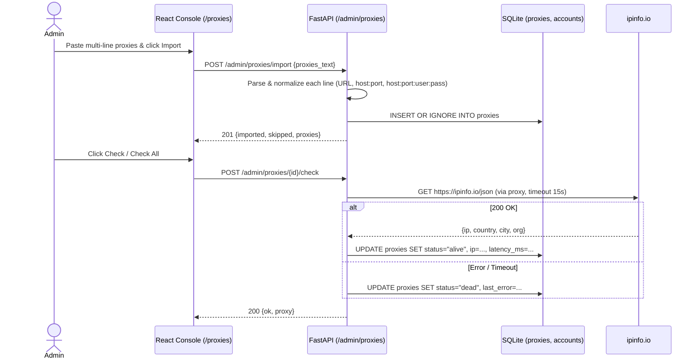

# Logic Design: Proxy Management

## 1. Sequence Diagram — Import & Check Proxy qua `ipinfo.io`

## 2. UI Event Handlers

| Phần tử UI | Sự kiện | API Endpoint | Tham số |
|---|---|---|---|
| `+ Import Proxies` → `Import` | `onSubmit` | `POST /admin/proxies/import` | `{proxies_text}` |
| `Check` (row) | `onClick` | `POST /admin/proxies/{id}/check` | `proxy_id` |
| `Check All` | `onClick` | `POST /admin/proxies/check-all` | `{}` |
| `Delete` (row) | `onClick` | `DELETE /admin/proxies/{id}` | `proxy_id` |

## 3. Thuật toán Parse & Chuẩn hóa Proxy
1. Với mỗi dòng sau khi `.strip()`: bỏ qua nếu rỗng hoặc bắt đầu bằng `#`.
2. Nếu chứa `://`: parse bằng `urllib.parse.urlparse`, kiểm tra scheme thuộc `("http", "https", "socks5", "socks5h", "socks4")` và có `hostname` + `port`.
3. Nếu không chứa `://`:
   - `parts = line.split(":")`
   - Nếu `len(parts) == 2` (`host:port`) → `http://{host}:{port}`
   - Nếu `len(parts) == 4` (`host:port:user:pass`) → `http://{quote(user)}:{quote(pass)}@{host}:{port}`
   - Nếu chứa `@` (`user:pass@host:port`) → `http://{line}`
4. Khi xóa proxy (`DELETE /admin/proxies/{id}`): tìm các `accounts` có `proxy_id = id`, đóng WSS connection của các account đó, rồi xóa bản ghi `proxies` (`ON DELETE SET NULL` tự động đặt `accounts.proxy_id = NULL`).
