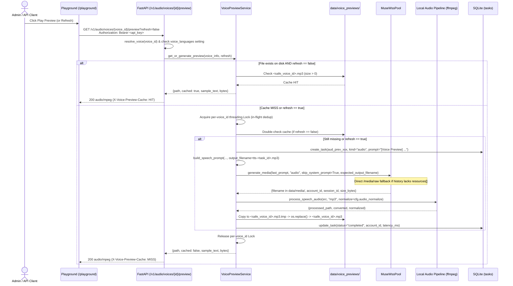
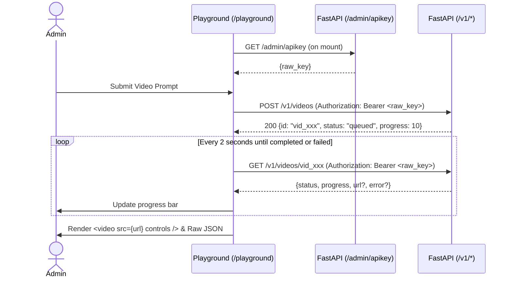

# Logic Design: API Playground & Voice Preview Cache

## 1. Sequence Diagram — Nghe thử Giọng đọc có Cache (`GET /v1/audio/voices/{voice_id}/preview`)



## 2. Sequence Diagram — Kiểm thử API bất đồng bộ (Video / Async Image) trên Playground



## 3. Xử Lý Sự Kiện Tương Tác Giao Diện (UI Event Handlers)

| Khu vực | Phần tử UI | Sự kiện | API Endpoint | Tham số / Hành vi |
|---|---|---|---|---|
| **Chung** | Mount `PlaygroundPage` | `useQuery` | `GET /admin/apikey`, `GET /v1/models` | Lấy `raw_key` làm Bearer token cho các request `/v1/*`; nạp danh sách model. |
| **Chat** | `Send` | `onSubmit` | `POST /v1/chat/completions` hoặc `POST /v1/responses` | `{model, messages/input, instructions, stream}`; đọc SSE stream bằng `fetch` + `ReadableStream` khi `stream=true`. |
| **Chat** | `Stop` | `onClick` | *(Client-side)* | Gọi `AbortController.abort()` để dừng stream đang chạy. |
| **Chat** | `Clear Chat` | `onClick` | *(Client-side)* | Xóa danh sách tin nhắn trong state React. |
| **Images** | `Generate Image` (Mode `Generations`) | `onSubmit` | `POST /v1/images/generations` | `{model:"muse-image", prompt, size, response_format, async, image?}`; nếu `async=true` poll `GET /v1/images/tasks/{id}`. |
| **Images** | `Generate Image` (Mode `Edits`) | `onSubmit` | `POST /v1/images/edits` | Gửi `multipart/form-data` (nếu upload file) hoặc JSON (nếu dán URL) kèm `prompt`, `size`, `response_format`, `async`. |
| **Video** | `Generate Video` | `onSubmit` | `POST /v1/videos` → `GET /v1/videos/{id}` | `{model:"muse-video", prompt, duration, size, image?}`; tự động poll mỗi 2s đến khi `completed` hoặc `failed`. |
| **Audio** | Filter / Search / Pagination | `onChange` | `GET /v1/audio/voices` | Query params `language`, `gender`, `tone`, `q`; lọc `cached only` ở client. |
| **Audio** | `Play` (dòng giọng) | `onClick` | `GET /v1/audio/voices/{voice_id}/preview` | Gọi `fetch` với Bearer token, tạo `URL.createObjectURL(blob)` phát trực tiếp và cập nhật trạng thái `cached=true` trong cache query. |
| **Audio** | `Regen` (dòng giọng) | `onClick` | `GET /v1/audio/voices/{voice_id}/preview?refresh=true` | Sinh lại file preview mới, phát lại và cập nhật stats. |
| **Audio** | `Use` (dòng giọng) | `onClick` | *(Client-side)* | Gán `voice_id` vào trường `Selected Voice` của form `POST /v1/audio/speech`. |
| **Audio** | `Clear Preview Cache` | `onClick` | `DELETE /admin/voices/preview` | Xác nhận modal/confirm, xóa toàn bộ file cache, invalidate query voices & stats. |
| **Audio** | `Generate Speech` | `onSubmit` | `POST /v1/audio/speech` | `{model, input, voice, instructions?, speed?, response_format}`; nếu `mp3` nhận Blob phát trên `<audio>`, nếu `url` phát từ `data.url`. |
| **Chung** | `Copy cURL` | `onClick` | *(Client-side)* | Sao chép lệnh `curl` tương ứng với state hiện tại vào clipboard. |

## 4. Thuật toán & Quy tắc xử lý Voice Preview Cache

### 4.1. Chuẩn hóa tên file cache
```python
import re

def safe_preview_filename(voice_id: str) -> str:
    safe = re.sub(r"[^a-zA-Z0-9_-]+", "__", voice_id.strip())
    return f"{safe}.mp3"
```
- Ví dụ: `avocado_v2:MAI_01` → `avocado_v2__MAI_01.mp3`.
- Luôn dùng `os.path.basename()` khi phục vụ file tại `GET /v1/voice-previews/{filename}` để chống path traversal.

### 4.2. Bảng câu mẫu cố định theo nhóm ngôn ngữ
Mỗi giọng được xác định nhóm ngôn ngữ qua `get_voice_language_group(voice_info)` và ánh xạ sang câu mẫu cố định (ngắn 2–4 giây):
- `Vietnamese`: `"Xin chào, đây là bản nghe thử giọng đọc để bạn kiểm tra chất lượng âm thanh."`
- `Japanese`: `"こんにちは、こちらは音声の品質を確認するためのサンプルボイスです。"`
- `Korean`: `"안녕하세요, 음성 품질을 확인하기 위한 샘플 미리듣기입니다."`
- `Chinese`: `"你好，这是一段用于试听音质和语气的语音样本。"`
- `French`: `"Bonjour, ceci est un court extrait vocal pour vous permettre d'écouter ma voix."`
- `Spanish`: `"Hola, esta es una breve muestra de voz para que puedas escuchar cómo sueno."`
- `German`: `"Hallo, dies ist eine kurze Stimmprobe, damit du hören kannst, wie ich klinge."`
- `Italian`: `"Ciao, questo è un breve campione vocale per farti ascoltare la mia voce."`
- `Portuguese`: `"Olá, esta é uma breve amostra de voz para você ouvir como eu soo."`
- `Russian`: `"Привет, это короткий образец голоса, чтобы вы могли оценить его звучание."`
- `Thai`: `"สวัสดีครับ นี่คือตัวอย่างเสียงพูดสั้นๆ เพื่อให้คุณทดลองฟังคุณภาพเสียง"`
- `Indonesian`: `"Halo, ini adalah contoh suara singkat agar Anda dapat mendengar kualitas suara saya."`
- `Arabic`: `"مرحباً، هذه عينة صوتية قصيرة لتتمكن من سماع نبرة وجودة الصوت."`
- Mặc định (toàn bộ 13 nhóm `English (*)`, `Indian`, `Finnish`, `Filipino`, `Malaysian`, `Other`):
  `"Hello! This is a quick voice preview so you can hear how I sound."`

### 4.3. Đồng bộ hóa In-Flight & Ghi nguyên tử
1. `VoicePreviewService` giữ một registry khóa theo `voice_id`: `_locks: dict[str, threading.Lock]` được bảo vệ bởi `_locks_guard = threading.Lock()`.
2. Khi có yêu cầu cho `voice_id`:
   - Nếu `not refresh` và file `<voice_preview_dir>/<safe>.mp3` tồn tại với `size > 0` → trả ngay (`cached=True`).
   - Ngược lại, lấy lock riêng của `voice_id` và kiểm tra lại lần 2 (double-checked locking) nếu `not refresh`.
   - Tạo `task_id = f"aud_prev_{secrets.token_hex(4)}"`, sinh tên file đầu ra duy nhất `output_filename = f"tts-{task_id}.mp3"` và gọi `build_speech_prompt(..., output_filename=output_filename)` (tiền xử lý câu mẫu và xuất Fast CLI prompt, xem Mục 3.5 của [OpenAI API Logic](../02_openai_api_and_keys/logic.md)).
   - Gọi `pool.generate_media(prompt, "audio", None, timeout=180, skip_system_prompt=True, expected_output_filename=output_filename)`.
   - Chạy `process_speech_audio(src_path, "mp3", normalize=cfg.audio_normalize, target_lufs=cfg.audio_target_lufs, true_peak=cfg.audio_true_peak, lra=cfg.audio_lra)` trên file vừa tải về tại `data/media/` để xác thực/convert MP3 và chuẩn hóa `-16 LUFS` / `-1.5 dBTP` (graceful fallback nếu thiếu `ffmpeg` và file đã là MP3 hợp lệ).
   - Chuyển file đã xử lý từ `processed_path` sang `<voice_preview_dir>/<safe>.mp3.tmp` rồi `os.replace()` thành `<voice_preview_dir>/<safe>.mp3` (xóa bản tạm ở `data/media/` để không chiếm dung lượng kép).
   - Cập nhật bản ghi `tasks` đã tạo (`status="completed"`, `media_filename=filename`, `account_id`, `session_id`, `latency_ms`).

## 5. Thông số kỹ thuật Backend
- **Config (`packages/backend/config.py`):**
  - Thêm property `voice_preview_dir` trỏ tới `os.path.join(self.data_dir, "voice_previews")`.
  - Tạo sẵn thư mục này khi khởi tạo app trong `main.py` (tương tự `cfg.media_dir`).
- **Service mới (`packages/backend/services/voice_preview.py`):**
  - `VoicePreviewService(cfg, db, pool)` với các phương thức: `is_cached(voice_id)`, `get_preview_filename(voice_id)`, `get_stats()`, `clear_all()`, `delete_one(voice_id)`, `get_or_generate(voice_info, refresh=False)`.
- **Routes bổ sung:**
  - `packages/backend/routers/v1_openai.py`:
    - Cập nhật `GET /v1/audio/voices` (và alias `/v1/voices`) trả thêm `language_group`, `cached`, `preview_url`.
    - Thêm `GET /v1/audio/voices/{voice_id:path}/preview` (cần `require_v1_api_key`, query `response_format="mp3"`, `refresh=False`).
    - Thêm `GET /v1/voice-previews/{filename}` (không cần auth, tương tự `/v1/media/{filename}`, kèm `Cache-Control: public, max-age=86400`).
  - `packages/backend/routers/admin_core.py`:
    - Thêm `GET /admin/voices/preview/stats`.
    - Thêm `DELETE /admin/voices/preview`.
    - Thêm `DELETE /admin/voices/preview/{voice_id:path}`.
- **CleanupService (`packages/backend/services/cleanup.py`):**
  - Giữ nguyên chỉ quét `self.cfg.media_dir`; tuyệt đối không đụng vào `self.cfg.voice_preview_dir`.
